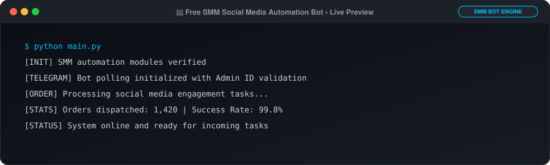
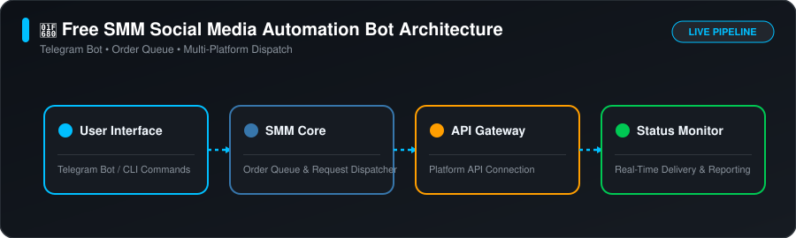

<h1 align="center">🚀 Free SMM Social Media Automation Bot</h1>

<p align="center">
  <a href="https://github.com/itzxsahil">
    
  </a>
</p>

<p align="center">
    
</p>

---

## 📸 Project Preview

<p align="center">
  
</p>

---

# 🚀 Overview

A Telegram-integrated SMM (Social Media Marketing) automation bot engineered to manage, dispatch, and track social growth and engagement services across platforms.

---

# 🏗️ System Architecture & Data Flow

<p align="center">
  
</p>

<br>

User orders submitted via Telegram bot commands are verified, queued, and dispatched across social platform API endpoints with automated status callbacks.

---

# ✨ Features

✅ **Telegram Bot Interface**: Clean interactive buttons and command workflows.\n✅ **Admin Controls**: Restrict administrative functions using `admin_id` in `config.json`.\n✅ **High Throughput**: Rapid asynchronous request dispatching.

---

# 📦 Installation & Quickstart

```bash
pip install -r requirements.txt
# Set token and admin_id in config.json
python main.py
```

---

# 👤 Author & Support
- Built with ❤️ by [@itzxsahil](https://github.com/itzxsahil)
- Star ⭐ this repository if you find it helpful!
